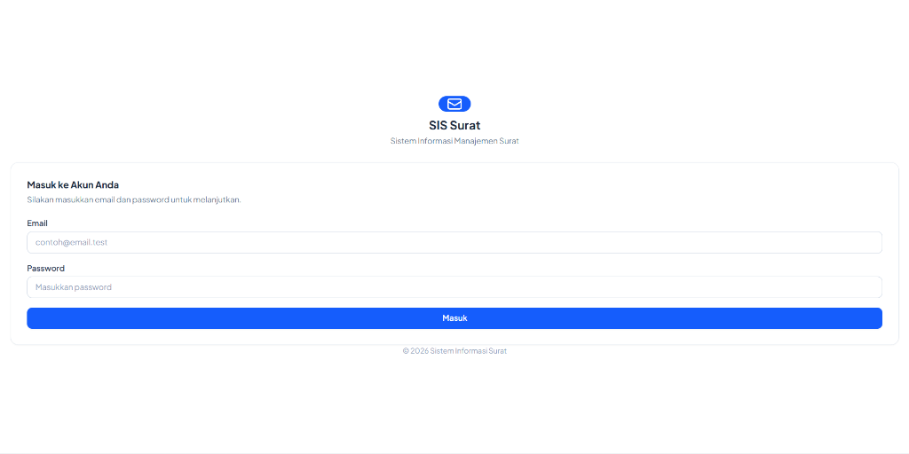
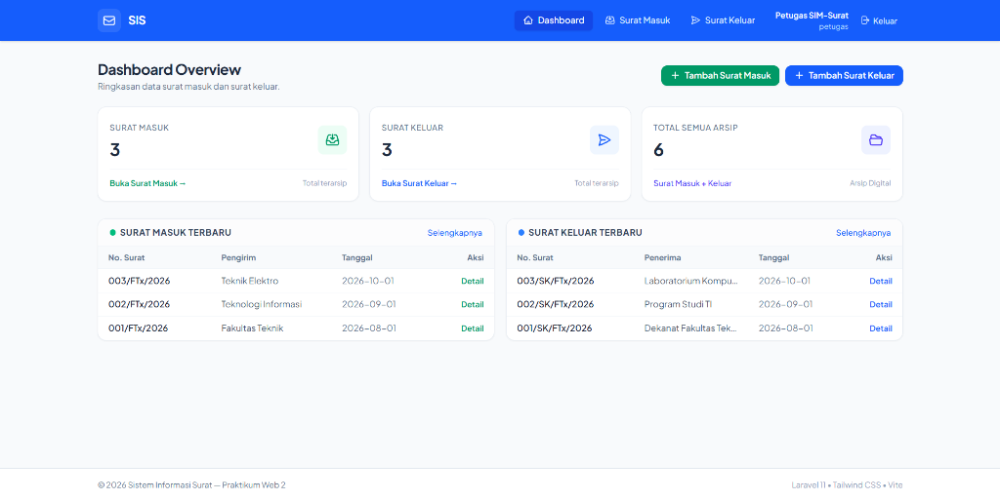
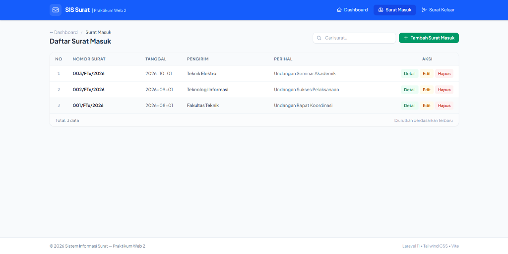
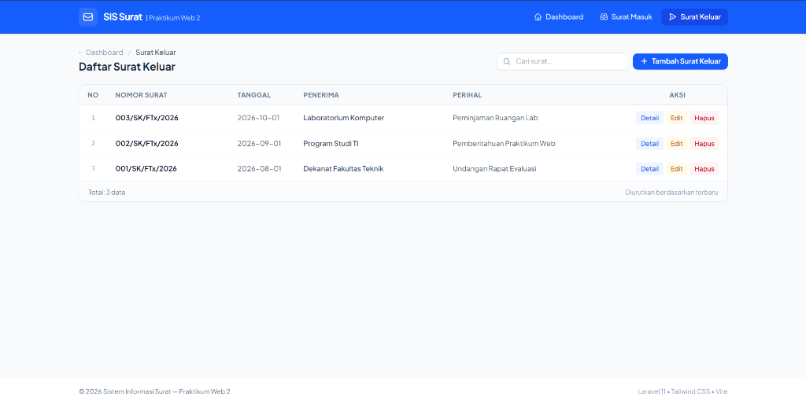

# Sistem Informasi Surat

Aplikasi web sederhana untuk pencatatan dan pengelolaan arsip surat masuk dan surat keluar, dibangun menggunakan Laravel 12 dan Tailwind CSS.

Proyek ini dibuat untuk membantu pengelolaan persuratan agar pencatatan nomor surat, tanggal, pengirim, penerima, serta perihal dapat terdata dengan rapi dalam satu sistem dengan dukungan autentikasi dan hak akses berbasis peran (*role-based access control*).

## Version Control (Riwayat Versi)

Repositori ini dikelola menggunakan Version Control System (Git) dengan penanda versi (*tags* dan *branches*) untuk memisahkan tahapan pengembangan sistem:

| Versi / Tag | Branch | Status | Deskripsi |
| :--- | :--- | :--- | :--- |
| **`v1.0.0-sebelum-login`** | `sebelum-login` | **Sebelum Login** | Versi awal sistem informasi surat sebelum implementasi autentikasi (semua fitur arsip dan CRUD dapat diakses publik tanpa login). |
| **`v2.0.0-sesudah-login`** | `main` / `sesudah-login` | **Sesudah Login** | Versi lengkap dengan fitur Autentikasi (Login/Logout), Otorisasi Role (`petugas` & `pembaca`), proteksi middleware, serta UI modern. |

Untuk beralih antar versi menggunakan Git:

```bash
# Beralih ke versi sebelum login
git checkout v1.0.0-sebelum-login
# atau
git checkout sebelum-login

# Beralih ke versi sesudah login (terbaru)
git checkout main
```

---

## Tampilan Antarmuka

### 1. Sebelum Login (Halaman Login)
Tampilan gerbang masuk sistem saat pengguna belum diautentikasi.
<p align="center">
  
</p>

### 2. Sesudah Login (Dashboard Overview)
Tampilan dashboard setelah pengguna berhasil masuk, menampilkan ringkasan data, menu navigasi, serta informasi akun dan hak akses pengguna.
<p align="center">
  
</p>

### 3. Daftar Surat Masuk
Tampilan manajemen arsip surat masuk.
<p align="center">
  
</p>

### 4. Daftar Surat Keluar
Tampilan manajemen arsip surat keluar.
<p align="center">
  
</p>

---

## Fitur Utama

- **Autentikasi Pengguna**: Login dan Logout aman dengan proteksi session dan CSRF token.
- **Otorisasi Berbasis Peran (*Role-Based Access Control*)**:
  - **Petugas**: Memiliki akses penuh untuk melihat, menambah, mengubah, dan menghapus (*CRUD*) arsip surat masuk dan keluar.
  - **Pembaca**: Memiliki akses hanya-baca (*read-only*) untuk melihat daftar dan rincian surat.
- **Dashboard Ringkasan**: Statistik jumlah surat masuk, surat keluar, total arsip digital, dan 5 arsip terbaru.
- **Manajemen Data Surat Masuk**: Nomor surat, tanggal, pengirim, perihal, dan keterangan lampiran.
- **Manajemen Data Surat Keluar**: Nomor surat, tanggal, penerima, perihal, dan keterangan lampiran.
- **Tampilan Detail Rincian**: Halaman khusus untuk melihat informasi lengkap setiap surat.

---

## Kebutuhan Sistem

- PHP >= 8.2
- Composer
- Database (MySQL / MariaDB / SQLite)
- Node.js dan npm

---

## Cara Menjalankan

1. Clone repositori:
   ```bash
   git clone https://github.com/ghostfaceeeeee/Sistem-informasi-surat.git
   cd Sistem-informasi-surat
   ```

2. Salin file konfigurasi environment:
   ```bash
   cp .env.example .env
   ```

3. Install dependensi PHP dan frontend:
   ```bash
   composer install
   npm install
   ```

4. Generate application key:
   ```bash
   php artisan key:generate
   ```

5. Sesuaikan konfigurasi database pada file `.env` (`DB_DATABASE`, `DB_USERNAME`, `DB_PASSWORD`).

6. Jalankan migrasi dan seeder database:
   ```bash
   php artisan migrate --seed
   ```

7. Build aset atau jalankan vite:
   ```bash
   npm run build
   # atau untuk mode development:
   npm run dev
   ```

8. Jalankan server aplikasi Laravel:
   ```bash
   php artisan serve
   ```

Aplikasi dapat diakses melalui browser di `http://127.0.0.1:8000`.

---

## Struktur Proyek

- `app/Http/Controllers/` : Controller logika surat masuk, surat keluar, dan autentikasi login
- `app/Models/` : Model Eloquent (IncomingLetter, OutgoingLetter, User)
- `database/migrations/` : Skema tabel database surat masuk, surat keluar, user, dan sessions
- `resources/views/` : Template antarmuka Blade (auth, layouts, surat-masuk, surat-keluar)
- `routes/web.php` : Rute web aplikasi dengan proteksi middleware `guest` dan `auth`

---

## Lisensi

Proyek ini bersifat open-source di bawah lisensi MIT.
